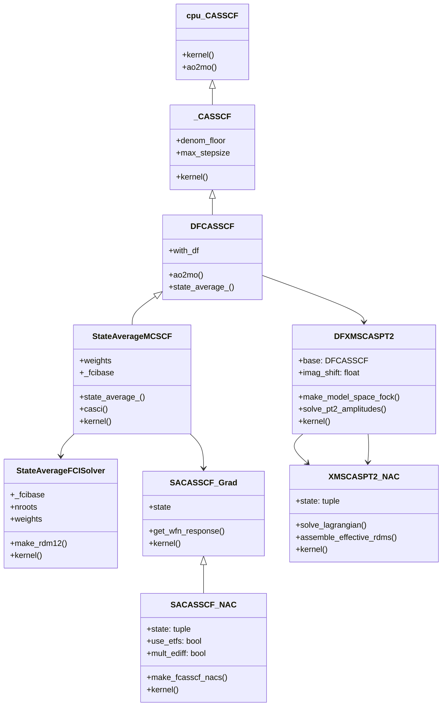

# 04. Software Architecture & GPU4PySCF Integration

## 1. Architectural Principles

To ensure seamless integration with the existing `gpu4pyscf` codebase, the SA-CASSCF and XMS-CASPT2 extensions must adhere to the core architectural principles established by PySCF and GPU4PySCF:

1. **GPU-Resident Execution:** Once molecular orbitals, integrals, and density matrices are transferred to the GPU, all iterations (FCI Davidson, orbital updates, Z-vector solves, gradient contractions) must remain on device. Host-device synchronization is minimized.
2. **PySCF Drop-in Compatibility:** Classes inherit from base PySCF classes while overriding internal kernels. Conversion methods (`to_gpu()` and `to_cpu()`) allow transparent interoperation between CPU and GPU objects.
3. **Density Fitting (DF) as the Core Engine:** All 4-center ERIs and their nuclear derivatives are evaluated via 3-center auxiliary expansions ($B_{pq}^P$ and $\nabla B_{pq}^P$), leveraging `gpu4pyscf.df.int3c2e`.
4. **Scanner & Gradient Factory Interfaces:** Objects expose `.nuc_grad_method()`, `.NACGradients()`, and `.as_scanner()` to directly drive geometry optimizations (`gpu4pyscf.geomopt`) and molecular dynamics (`gpu4pyscf.md.fssh`).

---

## 2. Directory Layout & Module Organization

```
gpu4pyscf/
├── fci/
│   ├── direct_spin1.py          <-- [Phase 1 COMPLETED: trans_rdm1, trans_rdm12 on GPU]
│   └── tests/
│       └── test_fci_rdms.py     <-- [Phase 1 COMPLETED: Multi-root & transition RDM tests]
├── mcscf/
│   ├── __init__.py              <-- Export DFCASSCF, StateAverageMCSCF
│   ├── casci.py                 <-- CASCI base with multi-root support
│   ├── casscf.py                <-- State-averaged orbital gradient & rotation
│   ├── df.py                    <-- [Phase 1 COMPLETED: DFCASSCF.state_average_]
│   ├── addons.py                <-- [Phase 1 COMPLETED: StateAverageMCSCF, state_average_]
│   └── tests/
│       └── test_sa_casscf.py    <-- [Phase 1 COMPLETED: Regression tests vs CPU PySCF]
├── grad/
│   ├── sacasscf.py              <-- SA-CASSCF analytical gradient & CP-MCSCF (Phase 2)
│   └── tests/
│       └── test_sa_grad.py      <-- Finite difference gradient tests
├── nac/
│   ├── sacasscf.py              <-- SA-CASSCF NACVs (Active, CSF, ETF options) (Phase 2)
│   └── tests/
│       └── test_sa_nac.py       <-- Finite difference NACV tests
├── caspt2/                      <-- NEW MODULE (Phase 3)
│   ├── __init__.py              <-- Export CASPT2, XMSCASPT2, DFXMSCASPT2
│   ├── caspt2.py                <-- Base CASPT2 class & level shifts
│   ├── xms_caspt2.py            <-- Average Fock diagonalization & XMS model space
│   ├── df_caspt2.py             <-- GPU tensor contractions for 8 manifolds
│   ├── grad.py                  <-- Analytical gradients (Lagrangian Z-vector)
│   ├── nac.py                   <-- Analytical derivative couplings
│   └── tests/
│       ├── test_xms_caspt2.py   <-- Energy tests vs OpenMolcas / BAGEL
│       └── test_xms_grad_nac.py <-- Gradient & NAC verification
└── md/
    ├── fssh_casscf.py           <-- NAMD driver for SA-CASSCF (Phase 4)
    └── fssh_caspt2.py           <-- NAMD driver for XMS-CASPT2 (Phase 4)

benchmarks/
├── bagel/                       <-- [Phase 1 COMPLETED: BAGEL benchmark suite]
│   ├── ethylene_cas44_sa3.json  <-- BAGEL input definition
│   ├── bagel_reference_ethylene_cas44.json <-- Baseline gold-standard reference
│   ├── run_bagel_reference.py   <-- Automated BAGEL runner & log parser
│   ├── run_gpu4pyscf_benchmark.py <-- GPU4PySCF benchmark runner & HDF5 export
│   ├── compare_bagel_gpu4pyscf.py <-- Cross-validation comparison driver
│   └── README.md                <-- Benchmark documentation
└── slurm/                       <-- [Phase 1 COMPLETED: Slurm HPC cluster batch suite]
    ├── run_benchmarks_hpc.sh    <-- Automated 4-stage batch submission script
    └── README.md                <-- HPC cluster execution & module documentation
```

---

## 3. Class Design & API Contracts

### 3.1 State-Averaged CASSCF API

```python
from gpu4pyscf import scf, mcscf

# 1. Base SCF calculation on GPU
mol = pyscf.M(atom='C 0 0 0; O 0 0 1.2', basis='def2-tzvp')
mf = scf.RHF(mol).density_fit(auxbasis='def2-tzvp-jkfit').run()

# 2. Initialize State-Averaged CASSCF (e.g., CAS(6,6), 3 singlet states)
mc = mcscf.DFCASSCF(mf, ncas=6, nelecas=6)
# Define state weights (e.g., equal weights for S0, S1, S2)
mc.state_average_(weights=[1/3, 1/3, 1/3])
mc.kernel()

# 3. Analytical Energy Gradient of State 1 (S1)
g_scanner = mc.nuc_grad_method(state=1)
grad_s1 = g_scanner.kernel()  # shape: (natm, 3)

# 4. Non-Adiabatic Coupling Vector between S1 and S2
nac_scanner = mc.NACGradients(state=(1, 2), use_etfs=True)
nac_12 = nac_scanner.kernel()  # shape: (natm, 3)
```

### 3.2 Extended Multi-State CASPT2 (DF-XMS-CASPT2) API

```python
from gpu4pyscf.caspt2 import DFXMSCASPT2

# 1. Initialize XMS-CASPT2 from converged SA-CASSCF
pt2 = DFXMSCASPT2(mc)
pt2.imag_shift = 0.1  # Park-Shiozaki imaginary level shift (Hartree)
pt2.frozen = None      # Optional core orbital freezing
pt2.kernel()

print("XMS-CASPT2 Adiabatic Energies:", pt2.e_tot)  # [E_S0, E_S1, E_S2]

# 2. Analytical XMS-CASPT2 Gradient
pt2_grad = pt2.nuc_grad_method(state=1)
f_s1 = pt2_grad.kernel()

# 3. Analytical XMS-CASPT2 NACV
pt2_nac = pt2.NACGradients(state=(1, 2))
d_12 = pt2_nac.kernel()
```

### 3.3 GPU Transition RDMs in `gpu4pyscf.fci` API

```python
import cupy as cp
from gpu4pyscf.fci import direct_spin1

# 1. Evaluate transition 1-RDM and 2-RDM on GPU between CI states I and J:
# ci_bra and ci_ket are CuPy device arrays or NumPy arrays on host
dm1_ij, dm2_ij = direct_spin1.trans_rdm12(
    ci_bra, ci_ket, norb=ncas, nelec=(nelecas_a, nelecas_b), reorder=True
)

# 2. Bra-Ket and particle permutation symmetry verification:
# Conjugation: dm1_ij == dm1_ji.T
# Trace property: Tr(dm1_ij) == 0 for orthogonal roots (I != J)
# Output tensors remain fully resident on GPU device as cupy.ndarray
```

---

## 4. Class Inheritance Hierarchy



---

## 5. Integration with the FSSH Dynamics Engine

The existing `gpu4pyscf.md.fssh` module provides a state-of-the-art implementation of Tully's Fewest Switches Surface Hopping. Integrating SA-CASSCF and XMS-CASPT2 into `gpu4pyscf.md` requires implementing `FSSH_CASSCF` and `FSSH_XMSCASPT2`:

```python
class FSSH_XMSCASPT2(FSSH):
    def __init__(self, pt2, states):
        self.pt2 = pt2.as_scanner()
        self.pt2_grad = self.pt2.nuc_grad_method()
        self.pt2_nac = self.pt2.NACGradients()
        super().__init__(pt2.mol, states)

    def evaluate_pes(self, position, cur_state, with_nacv=True):
        # 1. Update nuclear geometry on GPU
        mol = self.mol.set_geom_(position, unit='Bohr', inplace=False)
        self.pt2.reset(mol)

        # 2. Compute XMS-CASPT2 energies for all active states
        energies = self.pt2(mol)

        # 3. Compute nuclear force of the currently running state
        grad = self.pt2_grad.kernel(state=cur_state)
        force = -grad

        # 4. Compute all required pairwise NACVs on GPU
        nacvs = np.zeros((self.nstates, self.nstates, self.natm, 3))
        if with_nacv:
            for i, j in self.active_coupling_pairs:
                d_ij = self.pt2_nac.kernel(state=(i, j))
                nacvs[i, j] = d_ij
                nacvs[j, i] = -d_ij

        return PES(energy=energies, force=force, nacv=nacvs)
```

This interface directly unlocks full trajectory simulation with momentum adjustment along $\mathbf{d}_{ij}$, decoherence corrections, and energy conservation.

---

## 6. Implementation Status & Phase 1 Execution

### 6.1 Phase 1 Architectural Summary (COMPLETED)

Phase 1 of the GPU-accelerated excited-state and multireference framework is fully implemented and operational across the following architectural subsystems:

1. **State-Averaged CASSCF Core (`gpu4pyscf.mcscf.addons`, `gpu4pyscf.mcscf.df`):**
   - **`StateAverageMCSCF`:** Derived from `_CASSCF`, wrapping density-fitted CASSCF objects to perform state-averaged orbital optimization.
   - **`StateAverageFCISolver`:** Decorator wrapping the underlying `direct_spin1` solver; solves $N_{\text{roots}}$ in parallel on GPU and evaluates ensemble active 1- and 2-RDMs directly on device:
     $$\gamma_{pq}^{\text{SA}} = \sum_I w_I \gamma_{pq}^I, \quad \Gamma_{pqrs}^{\text{SA}} = \sum_I w_I \Gamma_{pqrs}^I$$
   - **Orbital Optimization:** Evaluates the state-averaged orbital gradient $g_{pq}^{\text{SA}} = 2(F_{pq}^{\text{SA}} - F_{qp}^{\text{SA}})$ and rotates MO coefficients via GPU-accelerated diagonal-Hessian updates (`gpu4pyscf.mcscf.casscf`).
   - **Device-Host Interoperability:** Transparent `to_cpu()` and `from_cpu()` transformations with robust multi-root CI vector serialization and checkpoint dumping.

2. **GPU Transition RDMs (`gpu4pyscf.fci.direct_spin1`):**
   - `trans_rdm1` and `trans_rdm12` provide device-native evaluation of $\langle \Psi_I | \hat{E}_{tu} | \Psi_J \rangle$ and $\langle \Psi_I | \hat{e}_{tuvw} | \Psi_J \rangle$ using the generalized CUDA `_build_t1` intermediate kernel.
   - Strict particle-permutation and bra-ket conjugation symmetry is enforced, with trace orthogonality ($\text{Tr}(\gamma^{IJ}) = \delta_{IJ} N_{\text{act}}$) guaranteed.

3. **BAGEL Cross-Code Benchmark & Slurm HPC Suite (`benchmarks/`):**
   - Automated 4-stage pipeline deployed in `benchmarks/slurm/run_benchmarks_hpc.sh`.
   - Automated numerical validation comparing GPU4PySCF and BAGEL on ethylene CAS(4,4) SA(3)-CASSCF in `cc-pvdz` / `cc-pvdz-jkfit`.

For the detailed gap analysis, milestone sign-offs, and upcoming Phase 2 (CP-MCSCF / Z-vector gradients & NACVs) roadmap, see:
**[08. Codebase Gap Analysis & Phase 1 Implementation Plan](08_codebase_gap_analysis_and_phase1_plan.md)**.

