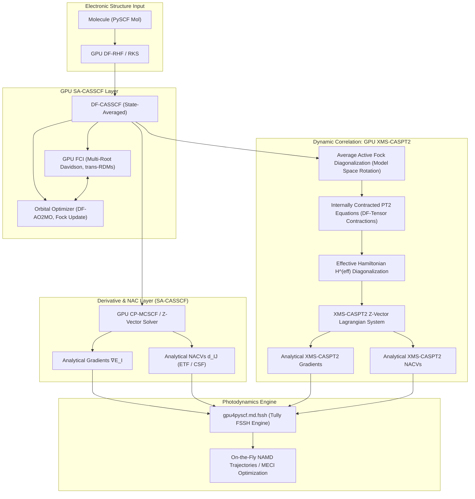

# GPU-Accelerated SA-CASSCF & XMS-CASPT2 with Non-Adiabatic Couplings (NAC) for GPU4PySCF
## Comprehensive Research & Knowledge Base System

Welcome to the knowledge base system for developing GPU-accelerated **State-Averaged Complete Active Space Self-Consistent Field (SA-CASSCF)** and **Extended Multi-State CASPT2 (XMS-CASPT2)** with analytical **Non-Adiabatic Coupling Vectors (NACVs)** in `gpu4pyscf`.

This system is engineered specifically to enable high-throughput, *ab initio* nonadiabatic molecular dynamics (NAMD) and photochemical reaction pathway exploration on modern NVIDIA GPUs.

---

### Knowledge Base Modules

1. **[01. Theory: SA-CASSCF Gradients & Non-Adiabatic Couplings](01_sa_casscf_and_nac_theory.md)**
   - State-averaged active space energy functional and stationarity conditions.
   - Coupled-Perturbed MCSCF (CP-MCSCF) / Z-vector formulation for state-specific gradients.
   - Analytical Non-Adiabatic Coupling Vectors (NACVs): active-space 1-TDM and 2-TDM terms, CSF derivative contribution, and Electron Translation Factors (ETFs).
   - Avoiding conical intersection singularities ($\Delta E \cdot \mathbf{d}_{IJ}$ vs $\mathbf{d}_{IJ}$).

2. **[02. Theory: XMS-CASPT2 Energy, Gradients & Derivative Couplings](02_xms_caspt2_theory.md)**
   - Breakdown of MS-CASPT2 invariance near conical intersections and the XMS-CASPT2 solution (Granovsky 2011, Shiozaki 2011).
   - Diagonalization of the state-averaged active-space Fock operator in the model space.
   - Internally contracted first-order wave functions and the 8 excitation manifolds ($A$ through $H$).
   - Active-space RDMs (1-RDM, 2-RDM, 3-RDM) and metric diagonalization.
   - Handling intruder states: real level shifts vs imaginary level shifts (Park & Shiozaki 2019).
   - Lagrangian-based analytical gradients and non-adiabatic derivative couplings (Park & Shiozaki 2017).

3. **[03. GPU Acceleration Strategies & Algorithms](03_gpu_acceleration_strategies.md)**
   - GPU-accelerated Density Fitting (DF-AO2MO) for 3-center integral transformations: $(P|\mu\nu) \to (P|pq)$.
   - GPU Full Configuration Interaction (FCI) solver enhancements: multi-root Davidson, transition 1- and 2-RDMs (`trans_rdm1`, `trans_rdm12`), and 3-RDM generation.
   - Batched matrix multiplication and tensor contraction offloading to cuBLAS via CuPy.
   - GPU Krylov subspace solvers for the CP-MCSCF / Z-vector linear response equations.
   - Memory management, GPU stream pipelining, and handling large basis sets.

4. **[04. Software Architecture & GPU4PySCF Integration](04_software_architecture_gpu4pyscf.md)**
   - Module layout within `gpu4pyscf`: `gpu4pyscf.mcscf`, `gpu4pyscf.grad.sacasscf`, `gpu4pyscf.nac.sacasscf`, and the new post-CAS module `gpu4pyscf.caspt2.xms_caspt2`.
   - API design for `SACASSCF`, `DFXMSCASPT2`, and gradient/coupling scanners.
   - Seamless compatibility with CPU PySCF objects (`to_gpu()`, `to_cpu()`).

5. **[05. Photochemistry & Non-Adiabatic Molecular Dynamics (NAMD)](05_namd_photochemistry_workflow.md)**
   - Interfacing with `gpu4pyscf.md.fssh` (Fewest Switches Surface Hopping).
   - Phase tracking across nuclear time steps ($\pm$ sign alignment of adiabatic states).
   - Velocity adjustment and momentum rescaling along the NACV direction ($\mathbf{d}_{IJ}$) vs energy difference gradient ($\Delta \mathbf{g}_{IJ}$).
   - Minimum Energy Conical Intersection (MECI) optimization using branching-space projection.

6. **[06. Benchmarking, Testing & Verification Plan](06_benchmarking_and_validation.md)**
   - Verification hierarchy: finite-difference gradients & couplings vs analytical implementations.
   - Cross-package validation against CPU PySCF (`pyscf.nac.sacasscf`), OpenMolcas, and BAGEL (`ethylene_bagel.json`).
   - Target benchmark photochemical systems (ethylene torsion, fulvene S1/S0 decay, retinal chromophore minimal model).
   - Decoupled Slurm HPC cluster execution scripts (`submit_sa_casscf.sh`, `submit_bagel_ethylene.sh`).

7. **[07. Annotated Literature Bibliography](07_annotated_bibliography.md)**
   - Comprehensive citations, abstracts, and key algorithmic insights from foundational literature (Snyder, Martínez, Shiozaki, Park, Granovsky, Werner, Celani, Tully, Subotnik).
   - Machine-readable BibTeX database: **[`references.bib`](references.bib)**.

8. **[08. Codebase Gap Analysis & Phase 1 Implementation Plan](08_codebase_gap_analysis_and_phase1_plan.md)**
   - Audited inventory of current `gpu4pyscf` capabilities on `feature/gpu-cas-extensions`.
   - Detailed component-by-component gap analysis (FCI, MCSCF, Gradients, NAC, CASPT2, FSSH).
   - **Phase 1 Completion Report:** Full production delivery of State-Averaged CASSCF (`gpu4pyscf.mcscf`), GPU transition RDMs (`gpu4pyscf.fci`), BAGEL benchmark inputs, and decoupled cluster execution scripts.

---

### Implementation Roadmap & Status Summary

| Phase | Target Capabilities | Status | Key Deliverables |
| :--- | :--- | :--- | :--- |
| **Phase 1** | **State-Averaged CASSCF, GPU Transition RDMs, BAGEL Benchmark & Standalone Runners** | **COMPLETED** | `gpu4pyscf.mcscf.addons`, `df.py`, `direct_spin1.trans_rdm12`, `run_sa_casscf.py`, `ethylene_bagel.json` |
| **Phase 2** | State-Specific Analytical Gradients & Analytical NACVs via CP-MCSCF / Z-Vector | Planned | `gpu4pyscf.grad.sacasscf`, `gpu4pyscf.nac.sacasscf`, GPU Krylov response solver |
| **Phase 3** | Extended Multi-State CASPT2 (XMS-CASPT2) Dynamic Correlation | Planned | `gpu4pyscf.caspt2.xms_caspt2`, model-space Fock, 8 excitation manifolds, imaginary shifts |
| **Phase 4** | GPU Non-Adiabatic Molecular Dynamics (NAMD) & MECI Optimization | Planned | `gpu4pyscf.md.fssh_casscf`, `fssh_caspt2`, wave function phase tracking, branching-space MECI |

---

### Project High-Level Architecture Overview

